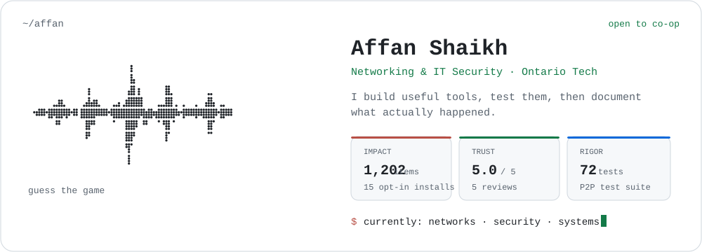

<picture>
  <source media="(prefers-color-scheme: dark)" srcset="./assets/profile-dark.svg">
  
</picture>

 

[portfolio](https://affan-shaikh.pages.dev) · [projects](https://affan-shaikh.pages.dev/log) · [LinkedIn](https://www.linkedin.com/in/sil6428) · [Ko-fi](https://ko-fi.com/sil6428)

I’m Affan. I study Networking and IT Security at Ontario Tech, and I usually start building something after the normal way of doing it annoys me for long enough.

## `~/selected-work`

**[OTNow](https://github.com/sil6428/OTNow)** — Canvas, but less scavenger hunt. A private-by-default browser extension that groups deadlines, notices moved dates, sends local reminders and keeps a useful offline cache.

**[P2P Messaging](https://github.com/sil6428/P2P-messaging)** — learning applied cryptography by making it argue with a network. Verified peers, protected Ed25519/X25519 identities, authenticated encryption, replay protection and 72 automated tests—with the unfinished security properties documented too.

**[File Integrity Monitor](https://github.com/sil6428/file-integrity-monitor)** — a small SHA-256 monitoring engine with a local Integrity Desk. It caught 45 of 45 controlled changes across a 500-file fixture set.

**[Interactive portfolio](https://github.com/sil6428/affan-interactive-lab)** — a fast, accessible case-file portfolio with an optional Three.js cyber-lab hidden behind it.

## `~/right-now`

- building out a Proxmox home lab for networking and security experiments
- documenting Cisco labs that taught me something instead of pretending they worked first try
- maintaining OTNow and turning Windows into a suspiciously Linux-looking desktop

<code>affan@github:~$ build something useful</code>

<!-- Visual direction informed by the profiles collected at https://www.reddit.com/r/github/comments/uulygm/ -->
