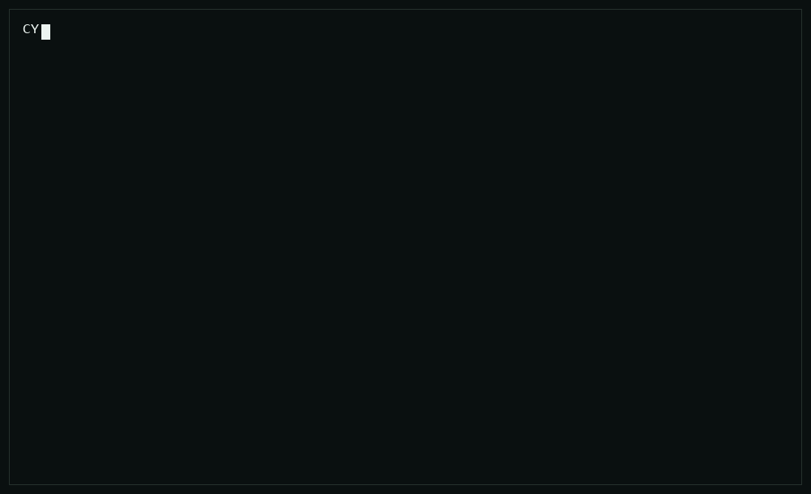

<div align="center">



<br>

<a href="https://affan-shaikh.pages.dev"></a>
<a href="https://affan-shaikh.pages.dev/Affan_Shaikh_Resume.pdf"></a>
<a href="https://www.linkedin.com/in/sil6428"></a>

</div>

## `~/whoami`

Hey, I’m **Affan**. I study Networking and IT Security at Ontario Tech, and I tend to build things whenever the normal way of doing something starts annoying me.

```text
user        Affan Shaikh
studying    networks, security, and the systems between them
currently   turning Windows into a suspiciously Linux-looking desktop
likes       useful tools · local-first software · evidence that things work
status      open to co-op opportunities
```

My projects usually begin with *“there has to be a better way to do this”* and end with considerably more code than expected.

## `~/currently`

- Making **OTNow** harder to break and easier for Ontario Tech students to trust.
- Building a **Proxmox home lab** for networking, infrastructure, and security experiments.
- Recording the Cisco labs that taught me something instead of pretending every configuration worked first try.
- Over-engineering **CyberGlass**, my Rainmeter-powered Windows desktop rice.

## `~/things-i-made`

### [OTNow](https://github.com/sil6428/OTNow) — because Canvas should not be a scavenger hunt

A private-by-default browser extension that gathers Canvas deadlines into one side panel, notices when dates move, sends local reminders, and keeps working from its last cache when Canvas does not.

<div align="center">

[](https://otnow-stats.sil6428-archtech.workers.dev/dashboard)
[](https://otnow-stats.sil6428-archtech.workers.dev/dashboard)
[](https://otnow-stats.sil6428-archtech.workers.dev/dashboard)
[](https://otnow-stats.sil6428-archtech.workers.dev/dashboard)

[Chrome Web Store](https://chromewebstore.google.com/detail/otnow/ekaachncjiajgiikgikhpafcnepompkn) · [live privacy-safe aggregate](https://otnow-stats.sil6428-archtech.workers.dev/dashboard)

</div>

### [P2P Messaging](https://github.com/sil6428/P2P-messaging) — learning cryptography by making it argue with a network

A collaborative learning prototype with verified peers, password-protected Ed25519/X25519 identities, ChaCha20-Poly1305 messages, encrypted history, replay protection, and 72 automated tests. It also documents what it **doesn’t** safely solve yet.

### [File Integrity Monitor](https://github.com/sil6428/file-integrity-monitor) — tiny tool, very suspicious personality

A dependency-free SHA-256 monitoring engine with CLI automation and a local Integrity Desk. It caught 45 of 45 controlled changes across a 500-file fixture set.

### [Interactive portfolio](https://github.com/sil6428/affan-portfolio) — the serious portfolio has a secret level

The accessible route is a fast case-file portfolio. The optional route is a Three.js cyber-lab and simulated desktop because a plain projects page felt too easy.

### [Secure File Transfer](https://affan-shaikh.pages.dev/log/secure-file-transfer) — private source, public receipts

An authenticated TLS service and loopback-only interface with recipient isolation, resumable uploads, two-sided SHA-256 verification, and tamper quarantine.

## `~/side-quests`

- **Cisco labs** — VLANs, trunks, inter-VLAN routing, DHCP, STP, NAT, OSPF/EIGRP fundamentals, packet captures, and the occasional topology that humbled me.
- **SSIK IT Consulting & Solutions** — co-founded with Ghayas Sher; I built the public site and a private, local-first operations workflow.
- **Arch Narrative** — Head of Internal Technical Operations for a 350+ volunteer organization.
- **CyberGlass** — a calm, terminal-shaped desktop sitting on top of Windows and an unreasonable amount of Rainmeter.

## `~/inventory`

```text
networking   Cisco IOS · Packet Tracer · Wireshark · IPv4/IPv6 · VLANs
security     TLS · applied cryptography · file integrity · access control
building     Python · FastAPI · JavaScript · React · Next.js · REST APIs
systems      Linux · Windows · Git · Proxmox · Cloudflare · Google Workspace
```

<details>
<summary><code>cat ~/.motd</code></summary>

<br>

> I would rather describe a smaller verified result accurately than make a broad claim I cannot explain in an interview.

```console
affan@cyberglass:~$ ./next-step
build something useful

affan@cyberglass:~$ echo $SUCCESS
works twice, has tests, and I can explain why
```

</details>

---

If you are building something useful, weird, or preferably both: **[say hello](https://affan-shaikh.pages.dev/contact)**.
